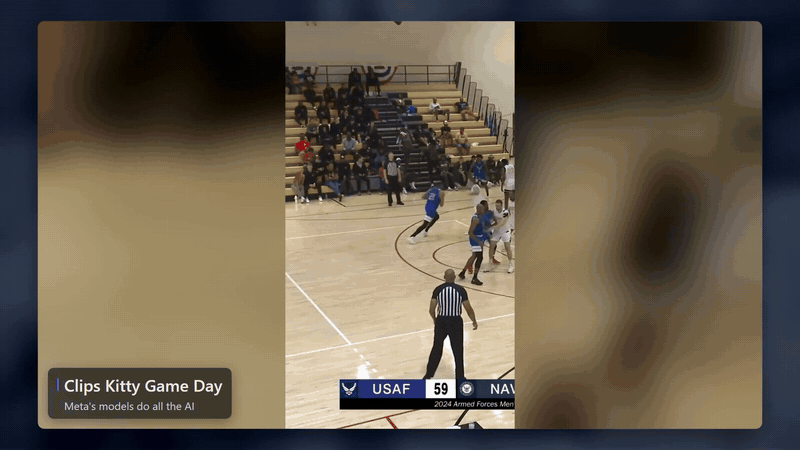
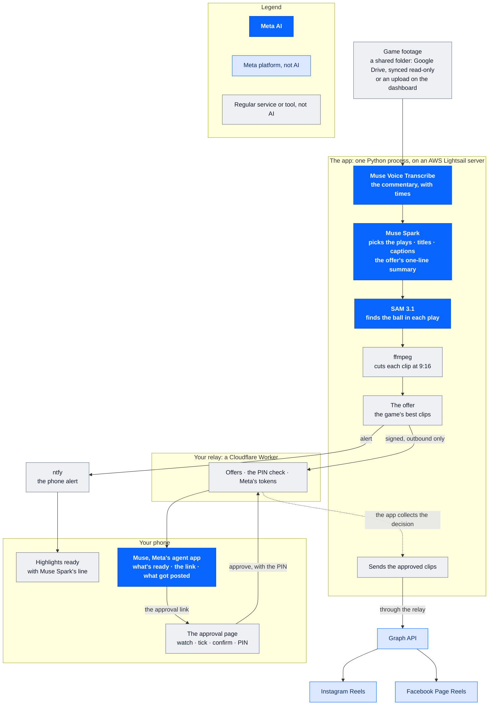

# Clips Kitty Game Day

[](https://youtu.be/1_QXVlY6cqE)

**Highlights posted while the game is still trending.** Meta's models cut
vertical clips that follow the ball, and nothing goes out to Instagram or
Facebook until you approve it on your phone.

- **[Watch the 2:50 demo on YouTube](https://youtu.be/1_QXVlY6cqE)**
- **Try it, with no account to make:** https://18-190-220-192.sslip.io, user
  `judge`, with the password in the hackathon submission.
  [What judges can do](docs/SUBMISSION.md#how-to-try-it)
- **Built for the Meta Global AI Developer Hackathon**, Indie track,
  problem statement *Build for Your World*.
- **Open source**, AGPL-3.0-or-later.

## What existed before this event, and what was built during it

- **Before this event (not in this repository):** [Clips Kitty](https://github.com/ColinGPT9/clips-studio),
  my desktop clipping app for streamers, with its own local vision models. It
  is not part of this entry, and nothing here depends on it.
- **Built during the event:** everything in this repository.
  - The phone relay (`meta-relay/`), the approval flow and the Instagram and
    Facebook publishing were written from 29 Oct to 2 Nov 2026 for this
    hackathon, on an event branch, and brought here.
  - The web app and its Meta-only engine were written here from the night of
    2 Nov 2026.
- [PROVENANCE.md](PROVENANCE.md) lists every imported file with its source
  commit and date. CI fails on any block of five lines of code shared with
  Clips Kitty as it was before the event.

## The story

I'm a Toronto Raptors fan, and I was inspired by the Instagram page House of
Highlights. Imagine you're the social media manager for an NBA team. You're
at the game, not at an editing desk, and the clips need to go out while
people are still talking about it.

| The usual way: hours | With Game Day: minutes |
|---|---|
| The footage gets recorded | The first quarter lands in a shared folder |
| Staff review it | Meta's models find the plays and cut them |
| An editor cuts it at a computer | You approve each post on your phone |
| Posted hours later, after the buzz | Posted while the game is still trending |

- **More reach and ad value for the team:** a highlight is worth the most
  while people are still talking about the game.
- **The manager stays at the game:** they approve each post with their PIN
  instead of editing at a computer.
- **More sports content on Meta's platforms:** more teams can post more Reels
  on Instagram and Facebook, for about 80 cents of Meta usage per 45-minute
  game.

## How it meets the judging rubric

### Impact

- **Who it's for:** whoever runs a team's Instagram and Facebook, and any
  league, school or creator who can't keep an editor at the arena.
- **What it changes:** posts go out in minutes, not hours. On 4 Nov a
  4-minute piece of a game went into the shared folder, the server found it
  by itself, and 4 vertical clips were ready about six minutes after the
  upload. One went out on Instagram and Facebook from a phone
  ([TEST_LOG.md](docs/TEST_LOG.md)).
- **Build for Your World:** clipping is the world I know. I built Clips Kitty
  for streamers before this event, and Game Day brings Meta's models into the
  job of a team's social media manager.

### Use of Meta AI tooling

- **Three Meta models in one pipeline, each doing a person's job:**
  - **Muse Voice Transcribe** writes down what the announcers say, with times.
  - **Muse Spark** reads it and picks the plays worth posting, held to a
    strict JSON schema: each play's window, kind of play, score and the
    commentary behind it. It writes each clip's title and caption, and the
    one-line summary that the phone alert, Muse and the approval page show.
    That line is checked before it's used, so it can't name a count the clips
    don't have.
  - **SAM 3.1** (hosted by Meta) finds the ball through each play, so the 9:16
    crop follows the action. Every clip says how much of it followed the ball.
- **Muse, Meta's agent app,** reaches the app through a custom connector I
  built: an MCP server with six tools. Muse says what's ready, hands over the
  approval link and says what got posted. No tool can approve or post.
- **Meta's Graph API** posts Instagram Reels and Facebook Page Reels.
- **What surprised me:** I expected a basketball-trained detector to beat a
  general model at finding the ball. On an offline test of 1,170 frames of the
  demo game, SAM 3.1 found the ball on 60% of them, against 32% for E-BARD, a
  YOLOv8 model trained on basketball. Near the rim it was 77 of 78 frames
  against 11
  ([how it compares](docs/SUBMISSION.md#how-sam-31-compares-and-whats-next)).

### Technical depth and execution

- **Nothing posts without you:** the approval page, the confirm box and your
  PIN. The PIN is never given to Muse or any assistant.
- **The Meta tokens never touch the server.** Meta's app secret and the
  account tokens live only on the relay. The relay never calls the app; the
  app only calls out.
- **Every Meta call is budgeted:** it checks a spending limit first and is
  logged with its estimated cost. The dashboard shows each stage's time and
  cost as it runs.
- **It fails safe:** without a key, or when a call fails, a run still
  finishes on simple fallbacks (loudness picks, a centre crop) and says so.
- **Judges get their own login.** It can upload and look; every other route
  is refused by default, and a judge's game is never offered on the owner's
  phone.
- **The shared folder is synced read-only.** A file is only clipped once it
  has fully arrived, and never twice.
- **Tested:** 571 Python tests pass in CI on Windows (568 on Ubuntu, where 3
  Windows-only tests are skipped) and 105 relay tests. CI also runs a check
  that fails on any AI other than Meta's, and a provenance check that fails on
  any code from before the event. [SECURITY.md](docs/SECURITY.md) covers
  what protects each step.

### Demo

- **The [2:50 video](https://youtu.be/1_QXVlY6cqE) is one real run:** the game
  into the shared folder, each model's stage, the phone alert, Muse, the PIN,
  and the Reels going up.
- **Try it yourself** on the hosted dashboard with the judge login, with
  nothing to sign up for ([how](docs/SUBMISSION.md#how-to-try-it)).
- **The posts are real:** [@clipskitty2 on Instagram](https://www.instagram.com/clipskitty2/)
  and its Facebook Page.

## What calls Meta's models, and what's a regular service

| Kind | Parts |
|---|---|
| **Meta model calls (AI)** | Muse Voice Transcribe (`muse-voice-transcribe-1.0`), Muse Spark (`muse-spark-1.3`) and SAM 3.1 (`sam-3.1`, hosted by Meta), through the Meta Model API. Nothing else in the app runs AI. |
| **Meta apps and platforms** | Muse, Meta's agent app (it asks the app what's ready, through the custom connector). The Instagram Graph API and Facebook Page Reels (posting), and Facebook Login for Business (connecting the Page): not AI. |
| **Regular services and tools (not AI)** | AWS Lightsail (the server), sslip.io (its address), Caddy with a Let's Encrypt certificate (HTTPS), Cloudflare Workers with D1 and KV (the phone relay and approval page), ffmpeg (cutting and rendering), SQLite, Python and FastAPI. Optional: Google Drive with rclone (the shared folder), and ntfy (phone alerts). |

`tests/test_meta_only.py` fails the build if any other AI package, import or
model host appears in the app.

## How it works



**Blue is Meta AI:** the three models the app calls, and Muse. **Light blue
is a Meta platform** (the Graph API, Instagram and Facebook). **Grey is a
regular service or tool**, with no AI in it.

- **The app** (`gameday/`) is one Python process: the dashboard (plain HTML,
  CSS and JavaScript), the HTTP API in [docs/API.md](docs/API.md), a job
  worker and a folder watcher, with SQLite in one data folder.
- **The relay** (`meta-relay/`) is a small Cloudflare Worker you deploy for
  yourself. It holds your Instagram and Facebook sign-in, serves the approval
  page and hosts the Muse connector. The app only ever calls out to it.

More in [docs/ARCHITECTURE.md](docs/ARCHITECTURE.md).

## What it does

- **Give it a game.** Drop a video file on the dashboard, copy it into a
  watched folder, or put it in a shared Google Drive folder: the server checks
  the folder every minute, read-only (`scripts/setup-drive-sync.sh`).
- **It finds the plays.** Muse Voice Transcribe writes down the commentary
  with its times. Muse Spark reads it and picks the plays: dunks, threes,
  blocks, steals, assists, clutch moments, fan reactions and other big
  moments. Each clip gets a title, a score and the commentary that made Muse
  Spark pick it.
- **It follows the ball.** SAM 3.1 finds the ball in each play, and the 9:16
  crop moves with it. Each clip says how much of it followed the ball, and
  **How it follows the ball** shows SAM's box and the crop on a frame.
- **It asks before posting.** When a game is done, the clips are offered on
  your phone. Ask Muse what's ready and it hands you the link, and the
  approval page asks for your PIN. Only the clips and places you tick go up,
  as Instagram Reels and Facebook Page Reels.

Options: Basketball or Talk mode, clips per game (1 to 12), "Teams or
players" (a hint for Muse Spark), title cards, and a credit line added to
every caption (for footage you don't own, like the demo game's DVIDS notice).

## Quick start

Judges: try the hosted demo first, with nothing to install or sign up for:
[How to try it](docs/SUBMISSION.md#how-to-try-it).

You need Python 3.11 and ffmpeg.

```
git clone https://github.com/ColinGPT9/clips-kitty-gameday
cd clips-kitty-gameday
python -m venv .venv
source .venv/bin/activate          # Windows: .venv\Scripts\activate
pip install -r requirements.txt
python -m gameday
```

Open http://127.0.0.1:8080 and sign in as `owner`. The password is in
`data/owner-password.txt`, made on the first start (or set
`GAMEDAY_PASSWORD` before starting). In **Setup**, save your Meta key and
press **Test**. Then drop a game on **Game day**.

Step by step for Windows, macOS and Linux:
[docs/LOCAL_SETUP.md](docs/LOCAL_SETUP.md).

## Hosting

It runs as one process with one data folder, behind HTTPS. On a fresh Ubuntu
24.04 server it takes one command:
`sudo bash scripts/setup-lightsail.sh <your-ip-with-dashes>.sslip.io`.

- [docs/AWS_SETUP.md](docs/AWS_SETUP.md): AWS Lightsail, step by step.
- [docs/RUNNING.md](docs/RUNNING.md): what any host needs (packages,
  environment, port, the data to keep, uploads, network).

AWS (the server) and Cloudflare (the relay) only run this project's own code.
Neither provides any AI here: no AWS or Cloudflare AI service is called. The
only models are the three Meta models above.

## Phone approval

1. Deploy your relay and connect it in **Setup**:
   [docs/RELAY_SETUP.md](docs/RELAY_SETUP.md).
2. Set your approval PIN. Enter your PIN yourself. Never give it to an
   assistant.
3. Connect Facebook. It brings the Instagram account linked to your Page.
4. Connect Muse ([docs/MUSE_CONNECTOR.md](docs/MUSE_CONNECTOR.md)).
5. Switch on **Let me approve publishing from my phone**.
6. Optional: turn on **Phone alerts** in **Setup**. Your phone then buzzes
   through ntfy (a free app for iPhone and Android, no account) when a game is
   ready, with Muse Spark's line, or fails, and when a post goes up or fails.

When a game is ready, ask Muse "What highlights are ready?" or look at the
dashboard. On the approval page, watch the clips, tick the ones you want and
where they go, confirm, and enter your PIN. Muse can hand you the link, but
it can't approve or post anything. What protects each step:
[docs/SECURITY.md](docs/SECURITY.md).

## Costs

What running it cost me, measured. The Meta figures are estimates from
Meta's published prices, the same ones the dashboard shows.

| | What it cost me |
|---|---|
| **Meta models, per game** | **About $0.80** for a 45-minute game on the server, which made 8 clips. Muse Voice Transcribe cost $0.14, Muse Spark $0.03 and SAM 3.1 $0.62-0.66. Captions cost about a cent. Posting the Reels to Instagram and Facebook is free. |
| **Hosting: the server** (AWS Lightsail, 2 vCPUs, 4 GB RAM, 80 GB SSD) | **$24 a month** at Lightsail's price, about 80 cents a day. It clipped a 45-minute game in about 14 minutes. |
| **Hosting: the relay** (Cloudflare Workers) | $0, on Cloudflare's free plan |

The game runs are in [docs/TEST_LOG.md](docs/TEST_LOG.md).

## What's next

- **Ball tracking trained on basketball.** SAM 3.1 still missed about 40% of
  the frames in the offline test. Next: fine-tune Muse Glimmer on basketball
  footage. I didn't have the time this week, or access to a big enough GPU.
  The comparison used E-BARD (https://github.com/GabrieleGiudic/E-BARD), used
  unmodified under CC BY 4.0, offline only; the app only ever calls SAM 3.1.
- **WhatsApp alerts.** The relay has WhatsApp code from the event branch,
  tested only against a fake Meta. On 3 Nov I set it up with Meta's test
  number, but Meta locked the new WhatsApp Business Account (error 131031)
  before the first message went out. Alerts go through ntfy for now.
- **Threads.** Posting to Threads is next. I couldn't get its API working in
  time.

## Tests

```
python -m ruff check .
python -m pytest -q
cd meta-relay && npm test                 # Node 22.5 or later
python scripts/provenance_check.py --reference path/to/clips-studio
```

- `tests/test_meta_only.py` fails if any AI package, import or model host
  other than Meta's appears in the app, or if the app's model list is
  anything but the three Meta models above.
- `tests/test_static.py` fails if the dashboard has an inline script or
  style, or loads anything from another site.
- `scripts/provenance_check.py` fails on any block of five lines of code
  shared with Clips Kitty as it was before the event (clips-studio at
  6245e02).
- CI runs the Python tests on Windows (571) and Ubuntu (568, with 3
  Windows-only tests skipped), the relay's 105 tests on Node 22, the server
  setup script on Ubuntu 24.04, and the provenance check.

Runs on real games, with measured numbers, are in
[docs/TEST_LOG.md](docs/TEST_LOG.md).

Meta, Muse, SAM, Instagram and Facebook are Meta's trademarks.

## Demo footage

The demo uses Navy vs Air Force from the 2024 Armed Forces Men's Basketball
Championship.
- Video by Justin Fairley, 2D Audiovisual Squadron, on
  [DVIDS](https://www.dvidshub.net/video/939914).
- It is a U.S. government work, in the public domain.
- The appearance of U.S. Department of War (DoW) visual information does not
  imply or constitute DoW endorsement.

## License

AGPL-3.0-or-later. See [LICENSE](LICENSE).
