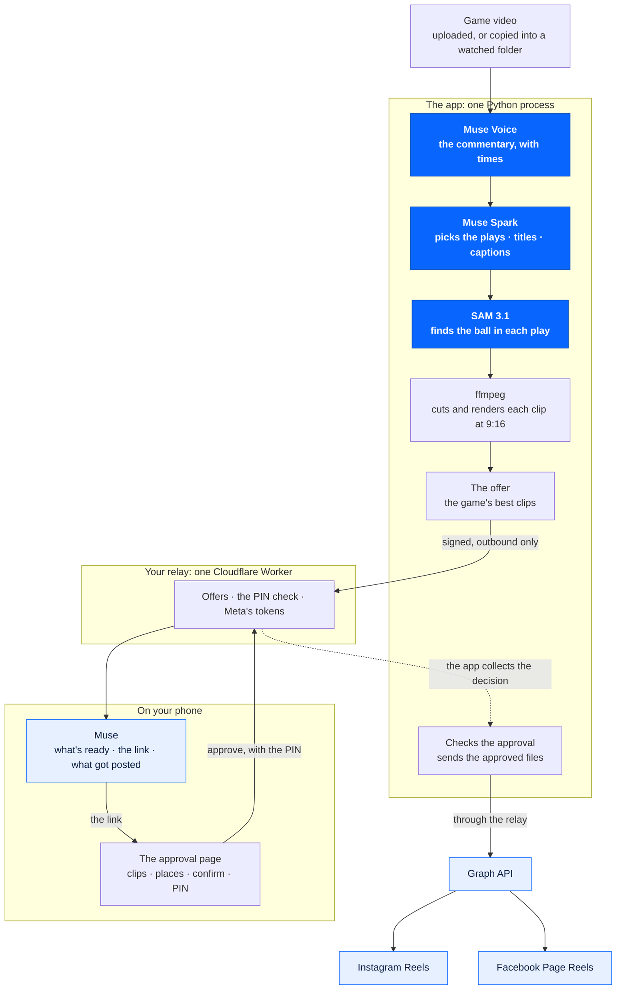

# Clips Kitty Game Day

Clips Kitty Game Day turns a basketball game into vertical highlight clips
using Meta's models. Before anything is posted to Instagram or Facebook, it
asks you on your phone.

## What existed before this event, and what was built during it

- **Before this event (not in this repository):** [Clips Kitty](https://github.com/ColinGPT9/clips-studio),
  a desktop clipping app with its own local vision models. It is not part of
  this repository, and nothing here depends on it.
- **Built during the event:** everything in this repository.
  - The phone relay (`meta-relay/`), the approval flow and the Instagram and
    Facebook publishing were written from 29 Oct to 2 Nov 2026 for this
    hackathon, on an event branch, and brought here.
  - The web app and its Meta-only engine were written here from 3 Nov 2026.

  [PROVENANCE.md](PROVENANCE.md) lists every imported file with its source
  commit and date.

## The Meta models it calls, and nothing else

| Model | What it does here |
|---|---|
| Muse Voice (`muse-voice-transcribe-1.0`) | listens to the commentary |
| Muse Spark (`muse-spark-1.3`) | picks the plays, and writes the titles and captions |
| SAM 3.1 (`sam-3.1`, hosted by Meta) | follows the ball for the 9:16 crop |

ffmpeg cuts and renders the clips. It is a tool, not a model.

## What it does

- **Give it a game.** Drop a video file on the dashboard, or copy it into a
  watched folder.
- **It finds the plays.** Muse Voice writes down the commentary with its
  times. Muse Spark reads it and picks the plays: dunks, threes, blocks,
  steals, assists, clutch moments, fan reactions and other big moments. Each
  clip gets a title, a score and the commentary that made Muse Spark pick it.
- **It follows the ball.** SAM 3.1 finds the ball in each play, and the 9:16
  crop moves with it. Each clip says how much of it followed the ball, and
  **How it follows the ball** shows SAM's box and the crop on a frame.
- **It asks before posting.** When a game is done, the clips are offered on
  your phone. Ask Muse what's ready and it hands you the link, and the
  approval page asks for your PIN. Only the clips and places you tick go up, as Instagram Reels
  and Facebook Page Reels.

Options: Basketball or Talk mode, clips per game (1 to 12), "Teams or
players" (a hint for Muse Spark), and title cards.

## How it works



**Solid blue: Meta's models** (Muse Voice, Muse Spark, SAM 3.1), the only AI
this app calls. **Light blue: Meta's apps and APIs** (Muse, the Graph API,
Instagram, Facebook).

- **The app** (`gameday/`) is one Python process: the dashboard (plain HTML,
  CSS and JavaScript), the HTTP API in [docs/API.md](docs/API.md), a job
  worker and a folder watcher, with SQLite in one data folder.
- **The relay** (`meta-relay/`) is a small Cloudflare Worker you deploy for
  yourself. It holds your Instagram and Facebook sign-in, serves the approval
  page and hosts the Muse connector. The app only ever calls out to it.
- Every Meta call checks the budget first and is logged with its estimated
  cost. With no key, or when a call fails, a run still finishes on simple
  fallbacks (loudness picks, a centre crop) and says so.

More in [docs/ARCHITECTURE.md](docs/ARCHITECTURE.md).

## Quick start

You need Python 3.11 and ffmpeg.

```
git clone https://github.com/ColinGPT9/clips-kitty-gameday
cd clips-kitty-gameday
python -m venv .venv
source .venv/bin/activate          # Windows: .venv\Scripts\activate
pip install -r requirements.txt
python -m gameday
```

Open http://127.0.0.1:8080 and sign in as `owner`. The password is in
`data/owner-password.txt`, made on the first start (or set
`GAMEDAY_PASSWORD` before starting). In **Setup**, save your Meta key and
press **Test**. Then drop a game on **Game day**.

Step by step for Windows, macOS and Linux:
[docs/LOCAL_SETUP.md](docs/LOCAL_SETUP.md).

## Hosting

It runs as one process with one data folder, behind HTTPS.

- [docs/RUNNING.md](docs/RUNNING.md): what a container needs (packages,
  environment, port, the volume to keep, uploads, network).
- [docs/AWS_SETUP.md](docs/AWS_SETUP.md): putting it on AWS.

## Phone approval

1. Deploy your relay and connect it in **Setup**:
   [docs/RELAY_SETUP.md](docs/RELAY_SETUP.md).
2. Set your approval PIN. Enter your PIN yourself. Never give it to an
   assistant.
3. Connect Facebook. It brings the Instagram account linked to your Page.
4. Connect Muse ([docs/MUSE_CONNECTOR.md](docs/MUSE_CONNECTOR.md)).
5. Switch on **Let me approve publishing from my phone**.

Muse doesn't message you when a game is done: ask it "What highlights are
ready?" (or set yourself a reminder in Muse), or look at the dashboard. On
the approval page, watch the clips, tick the ones you want and where they
go, confirm, and enter your PIN. Muse can hand you the link, but it can't
approve or post anything. What protects each step:
[docs/SECURITY.md](docs/SECURITY.md).

## Costs

Every figure is an estimate from Meta's published prices. The dashboard
shows the running total against your budget.

| Model | Price (estimate) |
|---|---|
| Muse Voice | $0.18 per hour of audio |
| Muse Spark | $1.25 per million input tokens, $0.15 per million cached input tokens, $4.25 per million output tokens |
| SAM 3.1 | $0.20 per 1,000 frames |

- `META_BUDGET_USD` (default $25): once estimated spending passes it, Meta
  calls are refused.
- **Measured on a real game (3 Nov 2026):** a 22.5-minute game made 8
  vertical clips for about **$0.65** of Meta usage, about **8 cents a
  clip**: Muse Voice $0.07, Muse Spark $0.02 and SAM 3.1 $0.56. It took
  under 4 minutes on a desktop PC. See [docs/TEST_LOG.md](docs/TEST_LOG.md).
- **Posting adds almost nothing.** Reels go to Instagram and Facebook
  through Meta's Graph API, which charges no fee. Muse Spark's captions
  for an offer cost under a cent: $0.004 for a one-clip offer, measured.
- The relay fits in Cloudflare's free plan for one owner.

## Tests

```
python -m ruff check .
python -m pytest -q
cd meta-relay && npm test                 # Node 22.5 or later
python scripts/provenance_check.py --reference path/to/clips-studio
```

- `tests/test_meta_only.py` fails if any AI package, import or model host
  other than Meta's appears, or if the app's model list is anything but the
  three Meta models above.
- `tests/test_static.py` fails if the dashboard has an inline script or
  style, or loads anything from another site.
- `scripts/provenance_check.py` fails on any block of five lines of code
  shared with Clips Kitty as it was before the event (clips-studio at
  6245e02).
- CI runs the Python tests on Ubuntu and Windows, the relay's tests on
  Node 22, and the provenance check.

Runs on real games, with measured numbers, go in
[docs/TEST_LOG.md](docs/TEST_LOG.md).

Meta, Muse, SAM, Instagram and Facebook are Meta's trademarks.
This project is not made or endorsed by Meta.

## License

AGPL-3.0-or-later. See [LICENSE](LICENSE).
