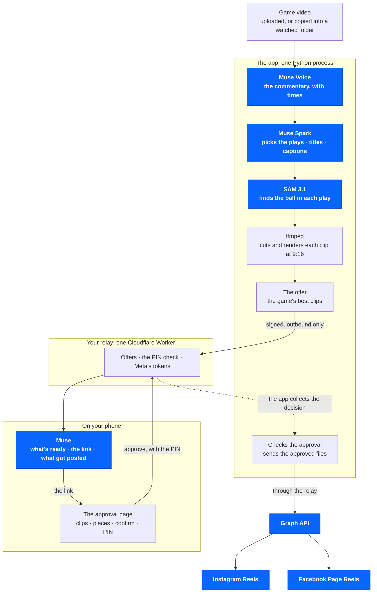

# Architecture

Meta's pieces are in blue.



**Blue: Meta's models and products.** The models are Muse Voice, Muse Spark
and SAM 3.1, the only AI this app calls. The products are Muse, the Graph
API, Instagram and Facebook.

## The parts

- **The app** (`gameday/`), one Python process:
  - `gameday/static/`: the dashboard, plain HTML, CSS and JavaScript, with
    no build step and nothing loaded from other sites.
  - The HTTP API in [API.md](API.md): Basic auth as `owner`, and the
    `X-Gameday-Action` header on every change.
  - `gameday/engine/`: the pipeline (`gameday.engine.pipeline.run`).
  - `gameday/meta_api/`: `MetaClient`, the only code that calls Meta's
    models.
  - `gameday/types.py`: the contracts between the parts.
    `gameday/media.py`: ffmpeg and ffprobe, the only programs the app runs.
  - The platform: the routes, the SQLite store, the job worker, the folder
    watcher, phone approval and publishing.
- **The relay** (`meta-relay/`), a Cloudflare Worker with D1, and optionally
  KV for the clips' preview videos. The owner deploys it once
  ([RELAY_SETUP.md](RELAY_SETUP.md)).
- **Meta**: the Meta Model API at `https://api.meta.ai/v1` for the three
  models; the Graph API for Reels; Facebook Login; and the Muse app,
  through a custom connector on the relay
  ([MUSE_CONNECTOR.md](MUSE_CONNECTOR.md)).

## One game, step by step

The dashboard's stepper shows the five stages in this order: Muse Voice,
Muse Spark, SAM 3.1, 9:16 and Captions.

1. **In.** A game arrives through the dashboard's upload (streamed to
   `DATA_DIR/uploads/`) or a watched folder (taken once it has stopped
   changing for 60 seconds, and only read). A job is queued with the
   settings at that moment: mode, clips per game, "Teams or players" and
   title cards.
2. **Muse Voice** (`muse-voice-transcribe-1.0`, `POST /asr/transcribe`)
   transcribes the game's audio, in chunks, into stretches of speech with
   their times.
3. **Muse Spark** (`muse-spark-1.3`, `POST /chat/completions`), held to a
   strict JSON schema, reads the commentary and picks the plays: each one's
   start and end, title, category (clutch, dunks, threes, blocks, steals,
   assists, fan reactions, big moment and so on), score, and the commentary
   that made it pick it.
4. **SAM 3.1** (`sam-3.1`, `POST /responses`, streamed) looks at a short
   H.264 copy of each play, made by ffmpeg, at 10 frames a second by
   default, and returns every box it finds for "basketball". The 9:16 window
   follows the ball. Each clip records how it was steered (the ball, a
   blend, the players, the centre, or in Talk mode the speaker), the share
   of its frames with a usable ball box, and a note such as "Followed the
   ball 74% of the time".
5. **9:16.** ffmpeg cuts and renders each clip as a 1080×1920 H.264 and AAC
   MP4, with a thumbnail, and a debug image: the wide frame with SAM's box
   and the crop window (**How it follows the ball** in the dashboard). A
   clip ends on the frame before the broadcast's first camera cut after its
   play (to a close-up, the bench, a replay wipe), and never opens on a
   cutaway. The cuts are found in the game itself, every frame of the
   stretch around each clip, by plain pixel and colour statistics: no model.
6. **Captions.** Muse Spark writes each clip's caption for posting.
7. **The offer.** With **Let me approve publishing from my phone** on, the
   app sends the offer to the relay, signed. The relay keeps it for Muse.
   Muse doesn't message the owner: they ask it what's ready (or set a
   reminder in Muse), and the dashboard shows the offer too.
8. **The phone decides.** On the approval page, the owner watches the clips,
   ticks the ones to post and where, confirms, and enters the PIN. Muse can
   hand over the link, but can't approve.
9. **Posting.** The app collects the decision from the relay and checks it
   against its own record of the offer: the signature, that the offer is
   still open and unchanged, the clips, the places, the time. Then it sends
   each approved file to the relay, which runs the Graph API steps for
   Instagram Reels and Facebook Page Reels and returns the permalinks.
   The offer settles as published, partly failed or failed, from what the
   APIs confirmed.

Every Meta call checks the budget (`META_BUDGET_USD`) first, and is logged
with its model, purpose, status, time and estimated cost, whether it worked
or not (`GET /api/usage`). With no Meta key, or when a call fails, the run
still finishes on simple fallbacks (loudness picks, a centre crop) and says
so in the job's warnings.

## The offer's states

```
READY_FOR_REVIEW -> NOTIFICATION_PENDING -> NOTIFICATION_SENT -> AWAITING_APPROVAL
  -> DEFERRED | CANCELLED | EXPIRED
  -> APPROVED -> PUBLISH_QUEUED -> PUBLISHING -> PUBLISHED | PARTIAL_FAILURE | FAILED
```

Only these moves are allowed, and each is written to the audit log. From the
dashboard, an offer can be cancelled (before an upload starts), retried
(only what failed, under the same approval), asked again (a new offer for an
expired or cancelled one) or sent again (after the relay refused it).

## Data

All of it is under `DATA_DIR`: `gameday.db` (SQLite), `uploads/`,
`media/jobs/<job_id>/clips/` (served) and `media/jobs/<job_id>/tmp/`
(never served). See [RUNNING.md](RUNNING.md).

## On the relay

`meta-relay/worker.js` (the routes, offers, the approval page's actions,
the PIN lockouts, Muse keys, commands, previews, the Graph step gate, the
cron), `lib/meta.js` (Facebook Login, the Graph steps, uploads),
`lib/page.js` (the approval and status pages: server-rendered HTML, no
JavaScript, a strict CSP), `lib/crypto.js` (HMAC, AES-GCM sealing, PBKDF2
PIN hashing), `lib/muse.js` (the Muse connector), `lib/db.js` (database
helpers and the audit log) and `schema.sql` (D1). A cron every 10 minutes
expires offers and clears out old records.

## Why a relay

- The Facebook sign-in redirect, the Muse connector and the phone's
  approval page need public addresses that work without the owner's
  password. The app keeps every one of its own routes behind that password.
- Meta's app secret and the account tokens stay on a small server the owner
  controls, apart from the app and its data.
- An approval made while the app is off or busy waits on the relay, and the
  app picks it up when it next checks in.
- The relay is small: one Worker and one small database, within Cloudflare's
  free plan for one owner.
